We're excited to announce Bublik v2.20.0! <br />
This release adds an **iteration matrix** that lays a test's iterations out by
their parameters, and lets you **classify results** from the iteration matrix,
from **History** and from the **Multiple runs** page, across several runs at
once. **Access tokens** let AI agents, CI jobs and scripts call Bublik as you.
The **Runs** charts are redesigned, the sidebar gets a new **project
switcher**, Runs and History take values and expressions in **one filter
field**, and admins can now **revoke** import tasks. Tabs left open through an
update now **move to the new version** on their own.

### What's New

**Iteration Matrix** <br />
Show a test's iterations as a grid of their parameters instead of a long list,
and spot which combinations fail at a glance. Click a cell to see its
iterations and classify them.

**Classify From History and Multiple Runs** <br />
Pick results in History, on the Multiple runs page or in the iteration matrix,
even from several runs, and classify them under one issue in one go.

**Access Tokens for Agents and Scripts** <br />
Create a personal access token in Settings and use it in an MCP client, a CI
job or a script. The token acts as you, with your permissions.

**Redesigned Runs Charts** <br />
Group the Runs charts by day, week or month, and click a bar to list its runs.

**Project Switcher** <br />
Switch projects from a searchable list at the top of the sidebar. Bublik
remembers the last project you picked.

**Values and Expressions in One Field** <br />
Filter runs and history by exact values and by expressions in the same field,
as chips.

<!--truncate-->

## Highlights

### Iteration Matrix

A test with many parameters can run hundreds of iterations. In a list, it's
hard to tell whether the failures share a parameter value or are spread
evenly. The iteration matrix puts parameters on the rows and on the columns,
so a pattern stands out.

#### 1. Lay Out the Matrix

Open a run, expand a package and click a count of a test to list its
iterations, as before. Then click **Matrix** in the bar above them.

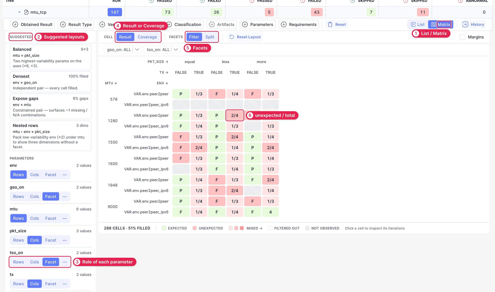

1. **List / Matrix.** Switches between the iteration list and the matrix. The
   filters in the bar, such as Obtained Result, Verdicts or Parameters, apply to
   both. The view and its layout are kept in the URL, so a link opens the same
   matrix.
2. **Suggested.** Ready-made layouts, worked out from the parameters of the
   test. **Balanced** puts the two parameters with the most values on the
   axes, **Densest** picks the pair that fills the most cells, **Expose gaps**
   picks the pair with the most missing combinations, and **Nested rows** packs
   a third parameter into the rows. Click one to apply it.
3. **Parameters.** Every parameter that varies gets a role: **Rows**, **Cols**,
   **Facet**, or **—** to leave it out. Give two parameters the same axis to
   nest them, as `mtu` and `env` are on the rows here. Parameters with a single
   value are listed as **FIXED**.
4. **Cell.** **Result** colours a cell by its results: green when all its
   iterations are expected, red when all are unexpected, and a shade of red for
   a mix. **Coverage** colours it by how many iterations it holds.
5. **Facets.** **Filter** shows one value of each facet parameter at a time,
   chosen in the chips under the header. **Split** draws one matrix per value
   instead. **Reset Layout** goes back to the default layout, and **Margins**
   adds row and column totals.
6. **Cells.** A cell with one iteration shows its result: **P**, **F** or
   **S**. A cell with several shows how many it holds, and a mixed one shows
   unexpected out of total, such as `2/4`. Hatched cells are combinations that
   never ran, and dashed ones are hidden by the current filters.

#### 2. Classify From a Cell

Click a cell to open its iterations in a drawer. Each one has the same
**Log**, **History** and **Preview** links as in the list.

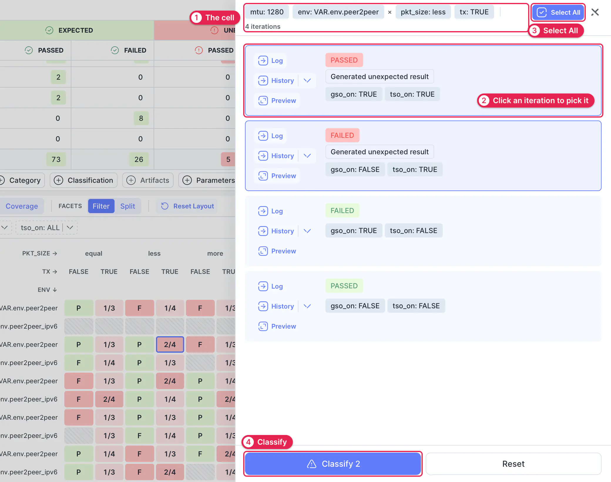

1. The cell's parameter values. The other parameters are shown on each
   iteration.
2. **Click an iteration** to pick it, as you pick rows in the list. Only
   failed results and results that are already classified can be picked. The
   picks join the same result selection, so you can pick from several cells
   and from the list and classify them together.
3. **Select All** picks every such iteration of the cell.
4. **Classify** opens the classify form for everything picked so far.

### Classify From History and Multiple Runs

Classification used to start on the run page only, with results of one run.
Now the same result selection works in more places, and one selection can
hold results of several runs:

- **Multiple runs.** Click results to pick them, of one of the runs or of
  several.
- **History.** In **List Of Results**, click a row to pick it. In **Groups Of
  Results**, click a group to pick every result in it at once, across all the
  runs it covers.
- **Iteration matrix.** Pick iterations from a cell, as shown above.

As on the run page, only failed results and results that are already
classified can be picked, and a selection has to be of one project, since an
issue belongs to one project.

#### 1. Pick Results on the Multiple Runs Page

Select runs in the runs list and open them together with **Multiple** in the
sidebar. Then expand a package and click a count of a test to list its
results.

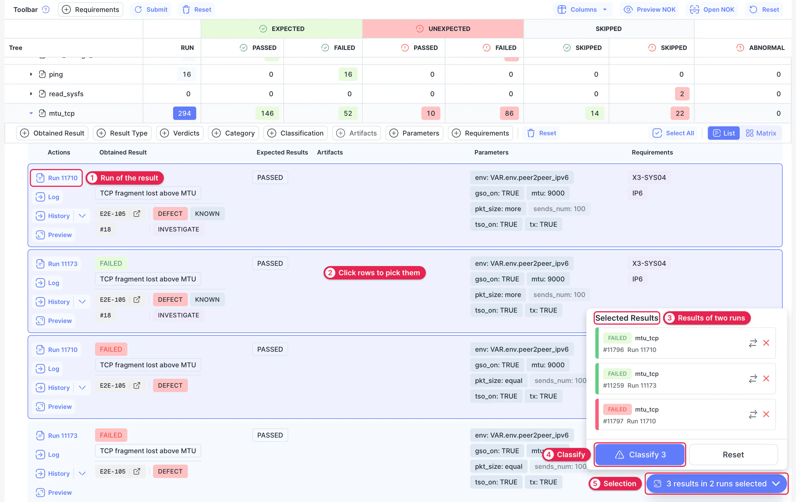

1. Each result names its **run** and links to it.
2. **Click rows** to pick them. **Select All** in the bar above picks every
   result listed.
3. **Selected Results** lists what is picked, with the run of each result.
4. **Classify** opens the classify form for all of them.
5. The **selection pill** says how many results and runs are picked. Click it
   to open or close the list.

#### 2. Fill In the Classify Form

Results of one run get the classify form they had before. When the picked
results come from several runs, the **Match scope** section of the form lists
the rules it is about to write, grouped by test path.

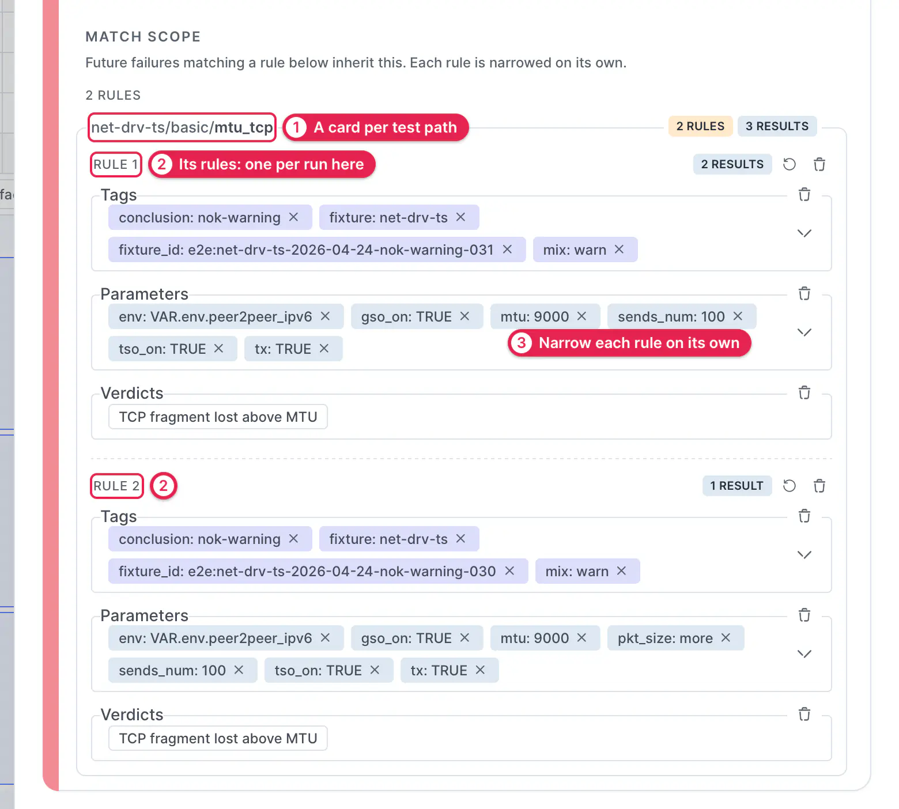

1. **A card per test path**, with the number of rules and results it covers.
2. **Its rules.** The results of a test get one rule per group of runs with
   the same important tags, so two runs with different tags give two rules,
   as here. Each rule says how many of the picked results it covers.
3. **Narrow each rule on its own.** A rule starts with the tags, parameters
   and verdicts its results share. Remove a value to match more widely, or
   empty a field to stop matching on it. Rules left with the same values are
   stored as one.

The whole selection is classified in one request: either every picked result
is filed under the issue, or none is.

#### 3. Pick Results in History

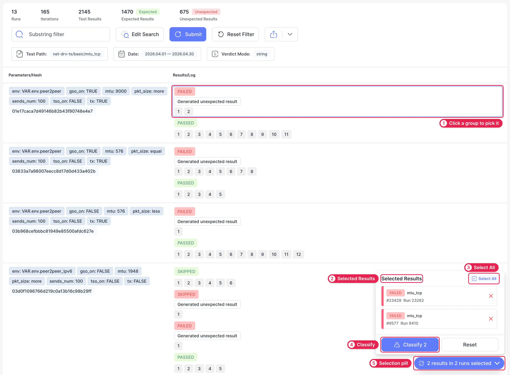

1. **Click a group** of results to pick all of them. Click it again to drop
   them. In **List Of Results**, click a row instead.
2. **Selected Results** lists what is picked, with the run of each result.
3. **Select All** picks every result listed on the page.
4. **Classify** files every picked result under one issue.
5. The **selection pill** says how many results and runs are picked.

The picks are kept while you change the filters, turn the page or switch
between List Of Results and Groups Of Results. Another test or another project
starts with an empty selection. Once the results are classified, the selection
is dropped and the rows show their new stamps. In List Of Results, a result
whose classification changes how it counts now shows the **SUPPRESSED** or
**STALE** chip, as on the run page.

The runs selection and the results selection now stack in one corner of the
page, and only one of their panels is open at a time.

### Access Tokens for Agents and Scripts

A personal access token lets a program call Bublik as you, with your
permissions: an AI agent through the [MCP server](/configuration/mcp), a CI
job or a script through the REST API.

Open **Settings → Access Tokens** from the account menu at the bottom of the
sidebar.

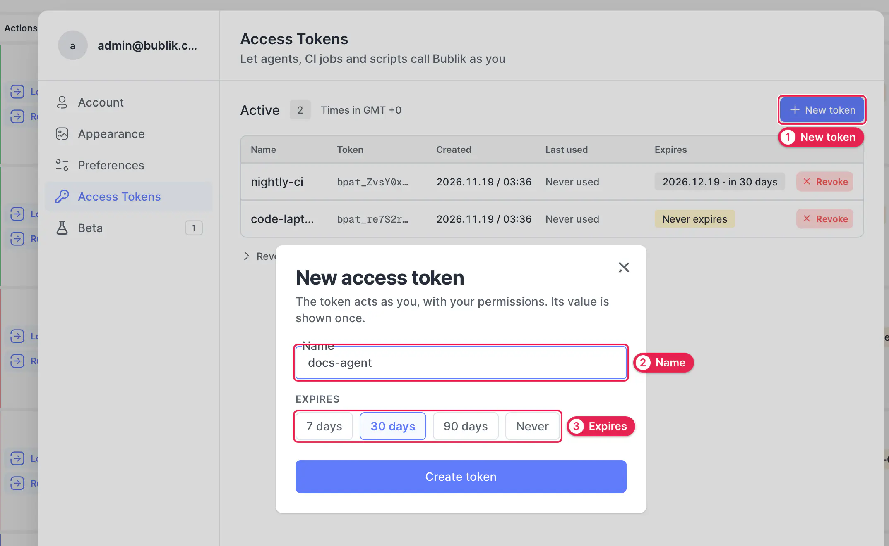

1. Click **New token**.
2. **Name** the token after where you will use it, such as `code-laptop` or
   `nightly-ci`.
3. Choose when it **Expires**: in 7, 30 or 90 days, or **Never**. A token that
   never expires keeps working until you revoke it.

After **Create token**, Bublik shows the token **once**:

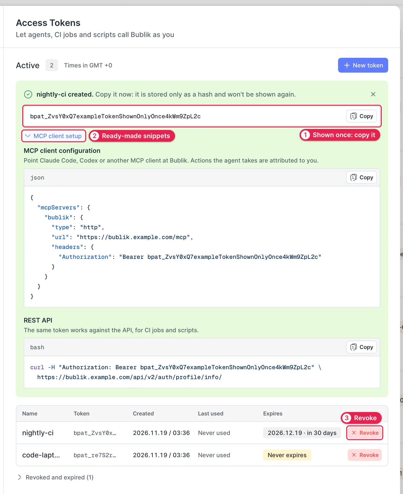

1. **Copy token** copies it. Bublik stores only its hash and can't show it
   again.
2. **MCP client setup** shows two ready-to-copy snippets with your token
   filled in: an MCP client configuration for Claude Code, Codex or another
   client, and a `curl` call to the REST API. Every request carries the token
   as `Authorization: Bearer <token>`.
3. The **Active** list shows each token's name, the start of its value, when
   it was created and last used, and when it expires. **Revoke** stops every
   client that uses the token on its next request. Revoked and expired tokens
   are listed below the active ones.

Admins see the tokens of every user under **Admin → Access Tokens** and can
revoke any of them. Token values are never shown there.

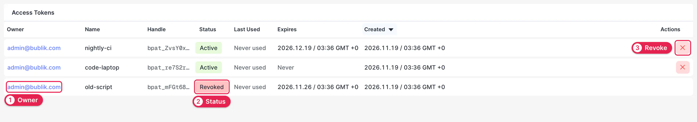

1. The **owner** of the token.
2. Its **status**: Active, Expired or Revoked.
3. **Revoke** an active token.

Good to know:

- An MCP client without a token keeps working anonymously, as before. A token
  that is wrong, expired or revoked gets a `401` with the reason instead.
- Tokens can't create or revoke other tokens, and they don't work for user
  administration. Both need you to be signed in.
- You can have up to 20 active tokens and create up to 10 per hour.
- When a user is deactivated, their tokens are revoked, and reactivating the
  user doesn't bring them back.
- On a server without a browser, an admin can issue a token from the command
  line: `python manage.py issue_user_token <email> --name <name> --expires 30`.
  `--expires` takes `7`, `30`, `90` or `never`.

### Redesigned Runs Charts

**Runs → Charts** is redesigned. It now shows the runs and test results of
the selected range over time.

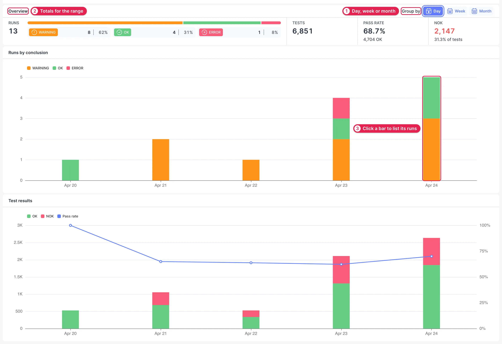

1. **Group by** **Day**, **Week** or **Month**.
2. **Overview** sums up the range: the number of runs broken down by
   conclusion, the number of tests, the pass rate and the number of NOK
   results.
3. **Click a bar** to list its runs.

**Runs by conclusion** stacks each period's runs by conclusion. **Test
results** stacks OK and NOK results and draws the pass rate as a line. A click
on a bar opens a drawer with the runs behind it, with links to their logs and
run pages:

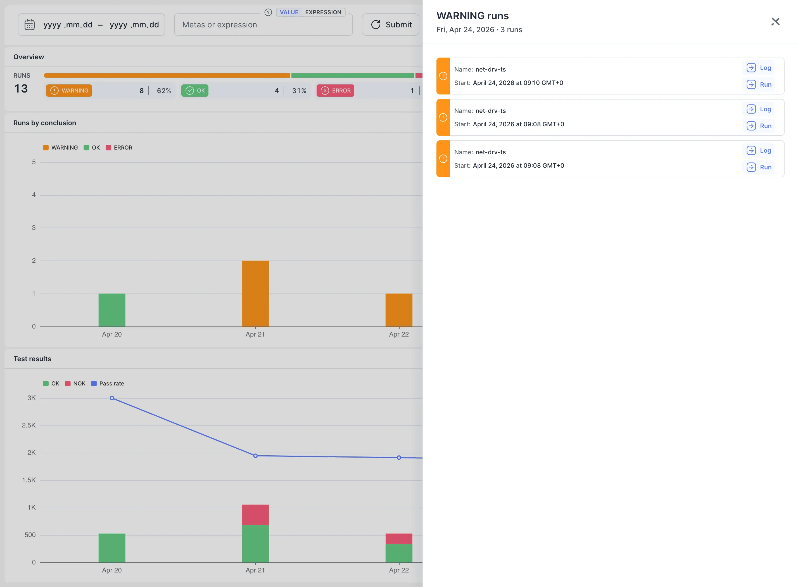

Zooming or hovering one chart moves the other one with it. Periods without runs
break the lines instead of joining them.

### Project Switcher

The project picker moved to the top of the sidebar, under the logo, and opens
a searchable list.

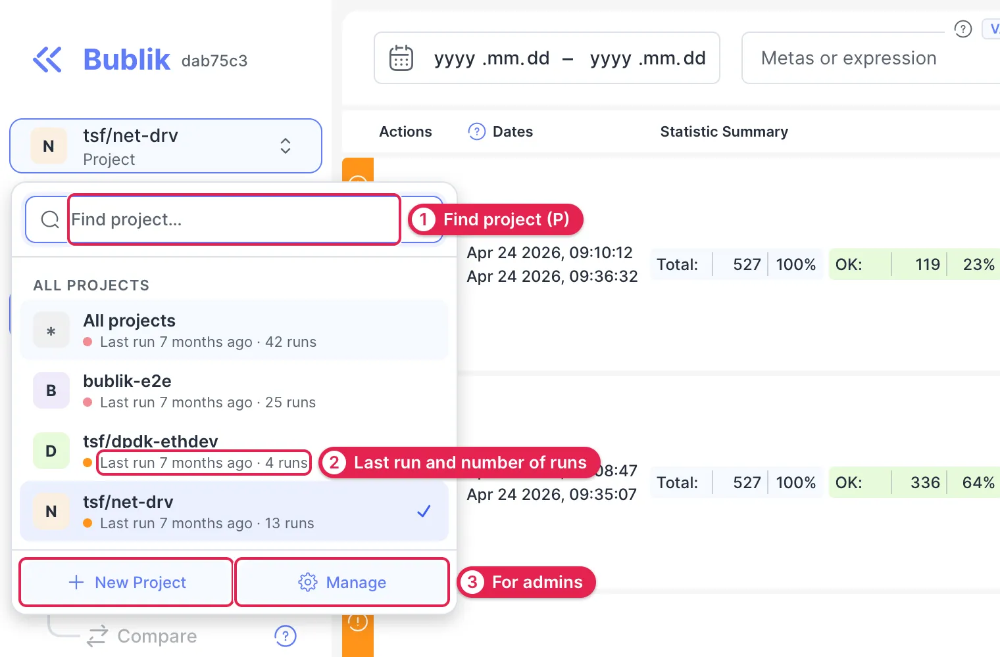

1. **Find project.** Type to narrow the list. Press `P` anywhere to open the
   switcher.
2. Each project shows when its last run was and how many runs it has.
   **All projects** shows the data of every project.
3. Admins get **New Project** and **Manage**, which opens the project configs.

Bublik now **remembers the last project you picked** in this browser. A new tab
opened without a project in its URL starts with that project instead of All
projects. A link with a project still opens that project, so shared links work
as before.

### Values and Expressions in One Field

The Runs page used to have one field for metas and another for a tag
expression, and the History search form had the same pair for tags, labels,
branches, revisions and parameters. Each pair is now a single field that takes
both.

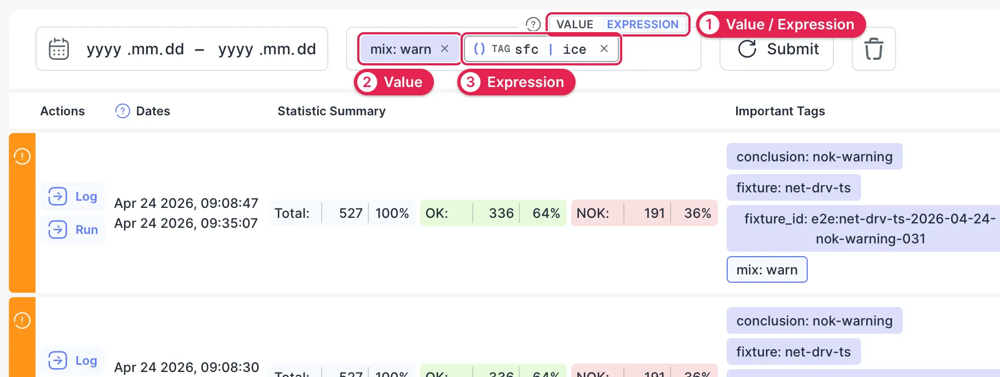

1. **Value / Expression** switches what Enter adds. Typing `&`, `|`, `!`, `(`
   or `)` switches to an expression on its own.
2. A **value chip**, picked from the suggestions, such as `mix: warn`.
3. An **expression chip**, such as `sfc | ice`. Click a chip to edit it.

An expression with `&` at the top level becomes one chip per term, and all
chips must match. The URL keeps values and expressions apart as before, so old
links open with the same filters, split back into chips.

### Import Tasks

**Admin → Import** can now stop an import. Every import that hasn't finished
has a **Revoke** button in its row. A queued import is never started. A running
one is terminated: if it has already saved the run, the run may miss part of
its post-processing, such as categorization. Bublik asks before revoking.

A revoked import gets the **REVOKED** status, which you can filter by, and the
**Try Again** action that failed imports have. An import terminated outside
Bublik, for example from Flower, gets the same status instead of staying
unfinished.

**Copy Log** in an import's log now copies every column: each line carries its
time, level and module, as `[time][level](module) message`. Before, it copied
only the messages.

Imports themselves got a number of fixes:

- Runs imported from XML logs (`bublik.xml`, `log.xml.xz` or a raw log bundle)
  now match those converted by the TE converter `rgt-bublik-json`: iteration
  dates are correct in every timezone, and objectives, verdicts, artifacts and
  TRC tags with line breaks, `&` or colons are no longer cut or split. Logs
  without an execution plan import again.
- Line graphs with sequence numbers on the X axis are saved, and so are the
  graphs after them in the same MI log. Force import a run to get them for runs
  imported earlier.
- A force import keeps the run's **compromised** mark. A force import that
  fails no longer leaves the run without its logs link, which made it
  impossible to import the run again.
- An import no longer fails when the connection to the database is lost, for
  example while the database server restarts. It is retried one, two and four
  minutes later, and fails only if the last attempt fails too.
- An import that is interrupted again and again fails after three attempts,
  instead of keeping a worker busy forever.
- Live import keeps the keys and notes of expected results whole, adds the
  keys and notes common to all of a test's expected results, and keeps the tag
  expression of unexpected results. It no longer fails when a key or notes
  arrive as `null`.
- When a failed import can't be reported by email, the import log gets a
  message that is safe to show. Before, it got the raw error, which could
  reveal internal details such as the address of the database server.
- On a bare-metal installation, the Celery worker is restarted after it fails.
  Before, it stayed down and no imports ran until someone restarted the
  service by hand.

### Links From Run Metadata

Runs often carry links as labels, such as a pull request or a deployment. These
values can now be links in the Info block of the run page and on the
dashboard. A link shows a short form of its URL: `#94` for a URL that ends in a
number, the first 7 characters of a commit hash, or the URL itself otherwise.

To set it up, assign the label to a meta category in the project's `meta`
config:

```json
"Docker PR": {
  "type": "label",
  "set-patterns": ["^DOCKER_PR$"]
}
```

Then add the category to `SPECIAL_CATEGORIES` in the project's `per_conf`
config to show it in the run's Info block, or add a dashboard column with the
`go_url` payload to `DASHBOARD_COLUMNS`:

```json
{
  "key": "Docker PR",
  "label": "Docker PR",
  "payload": "go_url"
}
```

Runs that are already imported pick up the new category when the config is
saved. Run comparison shows the same links, and a new bug report lists such
values as `name: url`.

### Open Tabs Move to the New Version

A tab left open while Bublik was updated kept running the previous version of
the UI. Sooner or later it asked the server for a file that was no longer
there, and the page stopped at "Something went wrong" until you reloaded it by
hand.

Now a tab notices an update on its own. It checks for a new version when you
come back to it and every five minutes. Once there is one, the next page you
open in Bublik is loaded in full, with the new version. Nothing on screen is
reloaded under you: changing filters, sorting or paging within a page never
triggers it. If a tab asks for a missing file before that, it reloads once
instead of showing the error.

On a bare-metal installation this needs the new nginx configuration, see
[Backend Update](#backend-update).

### Help Opens the User Guide

The `?` buttons in the sidebar now open the matching section of the new **User
Guide** in these docs, in a new tab. The guide has a page for every part of
Bublik, with up-to-date screenshots. It replaces the step-by-step help dialogs,
which covered only a few pages. The Page Help card in **Help → FAQ** and the
`?` in the run page toolbar open the guide too.

### Smaller Improvements

- **Page layout.** On screens wider than 1920px, choose how pages use the width
  under **Settings → Appearance → Layout**: **Full width** (the default),
  **Left sidebar**, with pages capped beside the sidebar, or **Centered**. The
  account menu has a Layout entry too. The choice is saved in your browser.

  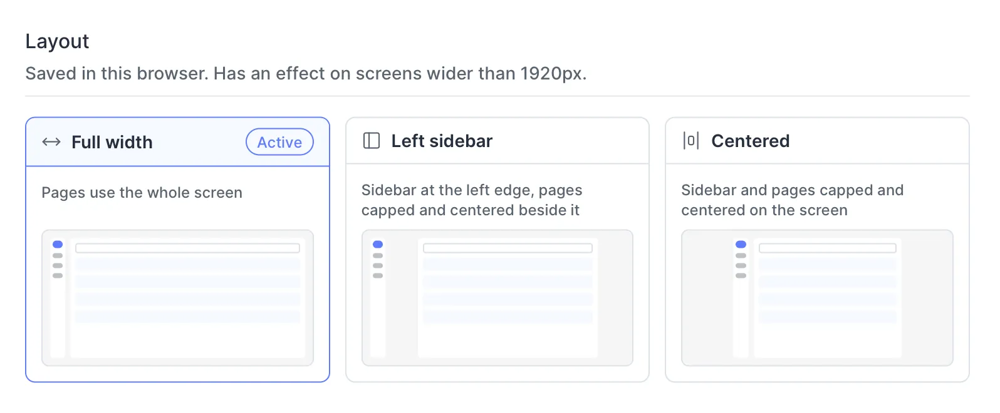
- **Log layouts.** **Settings → Preferences** now has three choices for the
  layout that log links in Bublik open in. Each is one of **Tree + info +
  log**, **Tree + log**, **Info + log** or **Log only**:

  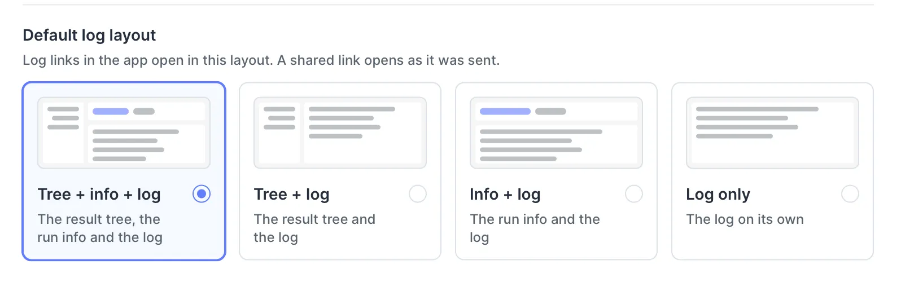

  1. **Default log layout** is for the log links that are neither in the runs
     table nor in History. It starts at Tree + info + log.
  2. **Log layout from Runs** is for the Log link of a run in the runs table.
     It starts at Tree + log.
  3. **Log layout from History** is for the Log links of History, including
     the results listed in Groups Of Results. It starts at Info + log.

  The links of Runs and History start at the layouts they always had, so they
  open as before until you change them. A link that names a layout, such as
  one shared with you, opens as it was sent. The Preferences options are now
  shown as cards and switches.

- **Run page.** The run header no longer has **Issues**, **Log**, **Reports**
  and **Source**, and the log toolbar no longer has **Run**, **Reports** and
  **Source**: the sidebar's **Run** section opens the same pages. Its Report
  row has a menu to choose among the run's reports. Clicking the row still
  opens the last report you visited, or the newest one. A new **Source** row
  opens the run's sources in a new tab.
- **Issue pages.** The issue page no longer has a **Results** button, and the
  issue results page no longer has a **Rules** link: the sidebar's **Issue**
  section opens both.
- **Run table columns.** In the **Columns** menu and in the table header,
  **Total**, **Expected Total** and **Unexpected Total** now sit next to the
  columns they sum up. Before, they came last, after Abnormal, unless the
  project's default columns listed them.
- **Numbers.** Counts in the run table and the **Results** column of the
  issues tables are right-aligned, with digits of equal width, so they're easy
  to compare down a column.
- **Rules.** After you save a rule, **Edit** and **Duplicate** open with its
  saved values. Before, they showed the values from the first time the form
  was opened, and saving again reverted the rule. **Duplicate** also keeps the
  rule's disposition. The new rule form has a **Match only failures without any
  verdict** checkbox.
- **Old log links** of the form `/log/<run>/<id>` keep their layout.
- **Chat.** On a server where chat is turned off, a direct link to `/chat` now
  says so instead of opening a chat whose requests all fail.
- **History.** Responses are cached per endpoint and query, so a request can no
  longer be answered from the cache of a different one.
- **Permissions.** If the global settings allowed reading configs without
  signing in, the configs of every project were readable, even of projects
  whose own settings didn't allow it. Each project's own setting now applies.
- **Admin → Users.** The users table looks like the Issues and Rules tables,
  with icon actions in its last column.
- **API.**
  - `POST /api/v2/importruns/revoke/` revokes an import task.
  - `/api/v2/auth/tokens/` lists, creates and revokes access tokens.
  - `GET /api/v2/auth/capabilities/` lists the actions the current user may
    perform, overall and per project.
  - `classify/options` and `classify` accept results of several runs of one
    project.
  - The import endpoints are described in the OpenAPI schema, and the schemas
    of the log and server endpoints match their actual responses.
  - The log endpoints answer an invalid `page` parameter with `400` instead of
    a server error.
- **MCP.**
  - The new `search_docs`, `get_doc` and `list_docs` tools let an MCP client
    and the chat answer questions about Bublik from these docs.
  - The MCP server keeps its response cache in memory, so a restarted server
    no longer answers from the previous run's cache, and two servers on one
    host no longer share it.
- **Docs.** Pages with a dot in their name, such as the release notes of
  `v2.10.5`, no longer return 404 when opened by a direct link.

## Admin Section

### Backend Update

1. `cd bublik`
2. `git remote update`
3. `git checkout v2.20.0`
4. `./scripts/deploy --steps django_settings celery_service nginx_conf migrate_db run_side_servers run_services`

:::warning
The `nginx_conf` and `run_side_servers` steps require root rights. They
install the new nginx configuration: files of the UI build are served with a
long cache lifetime and a missing one is a `404`, while `index.html` is
checked for changes on every request. Open tabs rely on it to
[move to the new version](#open-tabs-move-to-the-new-version). If nginx is
configured by hand on your host, apply the changes of
`templates/nginx.bublik.template` to your configuration.
:::

:::warning
Access tokens need `bublik.core.authentication.PersonalTokenAuthentication`
before `rest_framework_simplejwt.authentication.JWTAuthentication` in
`DEFAULT_AUTHENTICATION_CLASSES` of `bublik/settings.py`. The `django_settings`
step rewrites `settings.py` from the template, which has it. If you keep a
`settings.py` with your own changes, skip the rewrite and add the line by hand.
:::

:::warning
`GET /api/v2/runs/{id}/details/` now returns each value of
`special_categories` as an object with `name`, `value` and `url` instead of a
string. Update scripts that read this field.
:::

### Frontend Update

1. Trigger the workflow in your frontend repository
2. Synchronize the mirrors
3. `cd bublik-ui`
4. `git remote update`
5. `git checkout v2.20.0`

### Documentation Update

1. Trigger the workflow in your frontend repository
2. Synchronize the mirrors
3. `cd bublik-docs`
4. `git remote update`
5. `git checkout v2.20.0`

### Docker Instance Update

```bash
# 1. Backup the current db
task backup:create

# 2. Update the image tag in the .env file
sed -i "s/^IMAGE_TAG=.*/IMAGE_TAG=2.20.0/" .env

# 3. Pull the latest docker image
task pull

# 4. Start the docker container
task up
```

The nginx image of this release sends only the hashed files of the UI build
with a year-long cache lifetime. Fonts and the favicon are cached for a day,
and everything else, including `index.html`, is checked for changes on every
request. Nothing has to be configured by hand.

## Changelog

### Frontend

#### 🚀 New Feature

* **admin:** draw the users table like the issues table ([38400ea](https://github.com/ts-factory/bublik-ui/commit/38400ea67244109e315da0c558efefc781386dff))
* **admin:** list and revoke every user's access token ([98d3925](https://github.com/ts-factory/bublik-ui/commit/98d39250733954c4fec86b31ddeea958fdaa6728))
* **api:** add the access token endpoints ([07414dc](https://github.com/ts-factory/bublik-ui/commit/07414dc1bf990651cea97a9f65549b4578fd2de8))
* **app:** open the next page in a newly deployed build ([78c2cef](https://github.com/ts-factory/bublik-ui/commit/78c2cef9fa726871299cd8de5ce270f0a6ce11e1))
* **app:** reload when a chunk is gone after a new build ([02785e6](https://github.com/ts-factory/bublik-ui/commit/02785e6a19522decd015f82f46184d7ce97ae309))
* **build:** emit version.json with a build id ([e16478c](https://github.com/ts-factory/bublik-ui/commit/e16478c1b5d7dd8ad6afac6b2a7204414fa71946))
* **classification:** classify a selection that spans runs ([34f0e1b](https://github.com/ts-factory/bublik-ui/commit/34f0e1b6599dae65fe19278892adb061fc36f891))
* **classification:** edit each rule of the classify form on its own ([bcaf2c9](https://github.com/ts-factory/bublik-ui/commit/bcaf2c98fff065676e46decb03888b721773faea))
* **classification:** give each rule the form's own inputs ([f695866](https://github.com/ts-factory/bublik-ui/commit/f695866aec9a0b481bb30663cd46b234fb7a52ab))
* **classification:** group the classify form's rules by test path ([0d85e2d](https://github.com/ts-factory/bublik-ui/commit/0d85e2d91539ea343a5dff0a96ca661ae4d04d31))
* **classification:** keep only the runs' shared tags in one step ([b8ce58a](https://github.com/ts-factory/bublik-ui/commit/b8ce58a1dfb79f109db57629a55790229af317fe))
* **classification:** keep the classify form of one run's results as it was ([313d1a9](https://github.com/ts-factory/bublik-ui/commit/313d1a92ac0896256a9c9fd464e56a26bb68f435))
* **classification:** leave issue page navigation to the sidebar ([42976bf](https://github.com/ts-factory/bublik-ui/commit/42976bfec57119b1031db91eb96f586f524e3a87))
* **classification:** offer Select All in the selection popover ([8b2dfdc](https://github.com/ts-factory/bublik-ui/commit/8b2dfdcd68c84c8b22d8d2019a7be951152e8f0e))
* **classification:** show the verdict chip without a Classify button ([291462f](https://github.com/ts-factory/bublik-ui/commit/291462fb447db8d29aa06c49444918e1a778fbdb))
* **classification:** write rules as specific as the classified results ([f203345](https://github.com/ts-factory/bublik-ui/commit/f20334503b8dd0c407151a8d78bfcf94fafe868c))
* **history:** pick linear rows to classify them ([7b996cc](https://github.com/ts-factory/bublik-ui/commit/7b996cccd83deea35237f9e3b0a3cccd8cfe62dd))
* **history:** pick verdict groups to classify them ([a775563](https://github.com/ts-factory/bublik-ui/commit/a775563d77380d300579933b9d6fdb5a8348915d))
* **history:** select all listed linear rows from the popover ([f368501](https://github.com/ts-factory/bublik-ui/commit/f3685017fa3d2a6149fbfe30222da540c2b2fab4))
* **history:** show the classification chip on linear rows ([bd052ea](https://github.com/ts-factory/bublik-ui/commit/bd052ea8759ab416a0c6f2a7cc008db48cfe64b6))
* **history:** take values and expressions in one field per filter ([76bb630](https://github.com/ts-factory/bublik-ui/commit/76bb6308836c44f8822f7422e58bdff04ef84578))
* **import:** revoke unfinished import tasks ([45b0b5e](https://github.com/ts-factory/bublik-ui/commit/45b0b5eaf2e31b792a9aba06c99755f749587840))
* **import:** show revoked import tasks ([117e467](https://github.com/ts-factory/bublik-ui/commit/117e46772f837f209716089c2076fd7a65a19298))
* **layout:** let the page width be capped in a left or centered layout ([294d3e8](https://github.com/ts-factory/bublik-ui/commit/294d3e888df9f430e0e871d211c8e15eb1fe2998))
* **log:** add a default log layout preference for in-app log links ([ad26084](https://github.com/ts-factory/bublik-ui/commit/ad260843d97d52301c1f1ebc925959c777f64bdf))
* **log:** give Runs and History their own default log layouts ([d540964](https://github.com/ts-factory/bublik-ui/commit/d540964321cbde7b86ae057746c963f3ec4c5941))
* **projects:** add New Project and Manage to the switcher ([ebd0e34](https://github.com/ts-factory/bublik-ui/commit/ebd0e34f089c3fd68644a8eb84f13b284e932ac8))
* **projects:** switch projects from a searchable popover ([3cf90b3](https://github.com/ts-factory/bublik-ui/commit/3cf90b3c25da5adc0a3f159ce43ad1afa991ac1b))
* **run:** add iteration matrix analysis module ([be2008e](https://github.com/ts-factory/bublik-ui/commit/be2008e694cee6e3a968e036c4b8f154f8bbfd1d))
* **run:** add iteration matrix view component ([2753ece](https://github.com/ts-factory/bublik-ui/commit/2753ecedfb6227b3e31d056924277222d40f5ff4))
* **run:** add List/Matrix view toggle to the iteration table ([b6ce7fc](https://github.com/ts-factory/bublik-ui/commit/b6ce7fc9dcc18b68dae99666191b51ae13bb7240))
* **run:** build out the iteration matrix view ([96de0be](https://github.com/ts-factory/bublik-ui/commit/96de0be8ab8eb9eef61faf37a246eefa6be012d3))
* **run:** classify matrix cell iterations through the result selection ([403b155](https://github.com/ts-factory/bublik-ui/commit/403b15544990dc616881829da047bf579da72780))
* **run:** link special category values to their URLs ([52532c9](https://github.com/ts-factory/bublik-ui/commit/52532c9b77969b32959657c34132d9fb8ce42c20))
* **run:** move the run header's links to the sidebar ([54fb005](https://github.com/ts-factory/bublik-ui/commit/54fb005935d04e35d7181e7a21cc6a63e9ecd43d))
* **run:** right-align numbers in the run table ([93c240d](https://github.com/ts-factory/bublik-ui/commit/93c240d3400a966e49a33bd47b04fb8f5639669f))
* **runs:** break the run conclusions down in the overview ([7b8e9de](https://github.com/ts-factory/bublik-ui/commit/7b8e9de692ddb37a51ed07df0807423c526ee4e5))
* **run:** select results on the multiple runs page ([3098ef9](https://github.com/ts-factory/bublik-ui/commit/3098ef9fc42b1808aabf0005afc1c93092cf7567))
* **runs:** fill the page height with the runs charts ([e25ca2f](https://github.com/ts-factory/bublik-ui/commit/e25ca2f1455dd979c4e0988ba41349463f03da22))
* **runs:** filter runs by metas and expressions in one input ([112f6b4](https://github.com/ts-factory/bublik-ui/commit/112f6b42b230dbdf23d085965e7f5c45785e83a0))
* **runs:** group the runs charts by day, week or month ([9e4fe14](https://github.com/ts-factory/bublik-ui/commit/9e4fe14c335e8fb5d60247325f11d26c7491a137))
* **runs:** hover the runs charts' timelines together ([edcf826](https://github.com/ts-factory/bublik-ui/commit/edcf8269a43d7d3869ba095f52132c81b928c698))
* **runs:** label the charts period toggle and give each period an icon ([edba6a5](https://github.com/ts-factory/bublik-ui/commit/edba6a5a8550c5a5e622912542c00d311a2e999f))
* **runs:** list a chart's runs in a drawer ([5fe0519](https://github.com/ts-factory/bublik-ui/commit/5fe05199b007bb48ac501bef836746688b9c4fa0))
* **runs:** redesign the runs charts ([ede3669](https://github.com/ts-factory/bublik-ui/commit/ede366901f88b72185cb31a07242761a657bee01))
* **runs:** zoom the runs charts' timelines together ([312357b](https://github.com/ts-factory/bublik-ui/commit/312357b52a37adce8ed67fb678341ea6db67b87b))
* **settings:** show that the account row opens a menu ([3bd2b47](https://github.com/ts-factory/bublik-ui/commit/3bd2b479fb83800d4327ac0ea8f553d766bf3332))
* **sidebar:** keep the project picker under the logo ([0b53868](https://github.com/ts-factory/bublik-ui/commit/0b53868c6042385508f0ec87062a6648a0f48f17))
* **sidebar:** open the docs from the help buttons ([0923c40](https://github.com/ts-factory/bublik-ui/commit/0923c40e73544eed49285a4b84a52e1ec5e1cf36))
* **tokens:** manage access tokens from settings ([1f566f6](https://github.com/ts-factory/bublik-ui/commit/1f566f68685f8311d9c3f5cd69a33e295783f6f1))
* **ui:** add a highlighted code block with a copy button ([cfca16e](https://github.com/ts-factory/bublik-ui/commit/cfca16e3a9d3e0a1b6cbf1428c5a2a9ff30015eb))
* **ui:** add a meta filter input for value and expression chips ([68c30c7](https://github.com/ts-factory/bublik-ui/commit/68c30c7e5afb836f03a16923b15f94fdb493a4e7))
* **ui:** add SegmentedTabs ([3777670](https://github.com/ts-factory/bublik-ui/commit/3777670b57621301cbbac28cf28b7a366ecbaf70))
* **ui:** keep faceted filters to one row in a narrow toolbar ([2cb301d](https://github.com/ts-factory/bublik-ui/commit/2cb301dc834380fe3df692bf7cc9af25675b3824))

#### 💅 Polish

* **settings:** show preference choices as cards and toggles as switches ([67511a5](https://github.com/ts-factory/bublik-ui/commit/67511a55a648165804775888664bf4cecb9bef6d))
* **ui:** set conclusion badges in upper case ([53caf4e](https://github.com/ts-factory/bublik-ui/commit/53caf4e828b3b33f84f4c7619fac1aa6b14a6862))

#### 🐛 Bug Fix

* **app:** allow one automatic page load per minute ([53f29ad](https://github.com/ts-factory/bublik-ui/commit/53f29adadc0eb9141b61a2099ec63033f41438ac))
* **charts:** apply the tooltip shadow and corner radius ([5a18f3c](https://github.com/ts-factory/bublik-ui/commit/5a18f3c990767d80adf1bf7bd3b27d4adba623f8))
* **chat:** show a disabled state on /chat when chat is off ([973f014](https://github.com/ts-factory/bublik-ui/commit/973f014eaa6a96890438ea5f12027e7912c2e2a4))
* **classification:** keep a duplicated rule's disposition ([c78ebf3](https://github.com/ts-factory/bublik-ui/commit/c78ebf320540c8ead1fb726b13ccb81dbe483330))
* **classification:** keep a rule's "no verdicts" through Edit and Duplicate ([18deeab](https://github.com/ts-factory/bublik-ui/commit/18deeab19f15504e7d2b07ab3639b3f86da869b7))
* **classification:** reset the rule form when the rule changes ([3ad3dcd](https://github.com/ts-factory/bublik-ui/commit/3ad3dcd4653156e152bddd5633f8757fcb2e05f1))
* **classification:** right-align the Results counts in the issue tables ([39d623e](https://github.com/ts-factory/bublik-ui/commit/39d623e3f10241861f98e3365d05daed19f98375))
* **import:** copy every column of the import log ([b5a15be](https://github.com/ts-factory/bublik-ui/commit/b5a15be2a46a99572858e8b276ab79977abc0dc3))
* **log:** keep the layout of the legacy /log/:id/:old link ([e48c72a](https://github.com/ts-factory/bublik-ui/commit/e48c72a4665a5134bc25eebfa62345dab04c8e3d))
* **projects:** remember the last selected project for new tabs ([ae7ca62](https://github.com/ts-factory/bublik-ui/commit/ae7ca6257d9faae833a53bdf2c517c09ae213d33))
* **run:** group the column menu's totals with their columns ([712e715](https://github.com/ts-factory/bublik-ui/commit/712e71599faedb026d7acf97b0acd9b09ac13928))
* **runs:** break chart lines over periods without runs ([9855366](https://github.com/ts-factory/bublik-ui/commit/9855366d18647466dfd91d4e28eb0fd1d5835d9f))
* **runs:** clear unsubmitted filters on reset ([e9898af](https://github.com/ts-factory/bublik-ui/commit/e9898afdee465a3e3c78f827808758719e43583a))
* **runs:** fetch the runs once when the filters change ([9521b31](https://github.com/ts-factory/bublik-ui/commit/9521b3177d8e6c7b54c54e65f80f071568134c35))
* **runs:** keep Submit the same size when it turns primary ([21efeac](https://github.com/ts-factory/bublik-ui/commit/21efeac3fe0a19ee3e7d579536d1872d50e8c5d2))
* **runs:** read the runs filters from the current URL only ([f8c28c4](https://github.com/ts-factory/bublik-ui/commit/f8c28c485f8cd499a441d570f78e1e10e61e6cb6))
* **selection:** stack the runs and results selections in one dock ([bbae161](https://github.com/ts-factory/bublik-ui/commit/bbae161104795ad9452e73352dd25a9a87a7c118))
* **ui:** round the secondary split button ([04d2591](https://github.com/ts-factory/bublik-ui/commit/04d2591d0b26f2ac650ad48177dcf6c7b29dd4eb))

#### ♻ Code Refactoring

* **classification:** offer the selection's Classify outside its popover ([d94d15a](https://github.com/ts-factory/bublik-ui/commit/d94d15ab423551673a40a1e52782994f09a69321))
* **docs:** build docs links in one place ([8c78057](https://github.com/ts-factory/bublik-ui/commit/8c78057479975f61bff897ecceba1efbca95d169))

#### 👷‍ Build System

* **e2e:** bump Playwright to 1.65.0 ([c3f640e](https://github.com/ts-factory/bublik-ui/commit/c3f640e1a6a59614eaddb5c76444f0f153c447a5))

#### 🔧 Continuous Integration | CI

* **e2e:** time out the e2e job and its Playwright step ([f42e01b](https://github.com/ts-factory/bublik-ui/commit/f42e01bbaed919e24cb095e093f04ef5e52334b5))

#### ✅ Tests

* **e2e:** budget the import origin scenario by its tooltips ([3d630db](https://github.com/ts-factory/bublik-ui/commit/3d630db0a10cbe8acf64068afae7f2ccd50b0168))
* **e2e:** check Copy Log copies every column of the import log ([64d9d90](https://github.com/ts-factory/bublik-ui/commit/64d9d9005cab61b1de7aaf0ff83281827ca3231f))
* **e2e:** check that editing a rule again shows its saved values ([d62d6e9](https://github.com/ts-factory/bublik-ui/commit/d62d6e92d373cc70f48495a90da27affac4861e2))
* **e2e:** check the log layouts of the Runs and History log links ([d8d1a39](https://github.com/ts-factory/bublik-ui/commit/d8d1a396f427da2d9babbdb9ee77353dfb6a1a8e))
* **e2e:** check the page layout setting ([082d0a0](https://github.com/ts-factory/bublik-ui/commit/082d0a0809a9ab1cf69cfe2208eacd895cca7ab8))
* **e2e:** classify history rows picked across runs ([3d0ce9b](https://github.com/ts-factory/bublik-ui/commit/3d0ce9b021506521887a78959a13f44ad2505ee1))
* **e2e:** close the account menu past a tray tooltip ([3652a4a](https://github.com/ts-factory/bublik-ui/commit/3652a4a2503c004857d8f3727872343fd81208a0))
* **e2e:** count the classify form's rules, not its path cards ([f10a365](https://github.com/ts-factory/bublik-ui/commit/f10a365861667b477a24433d9bf4ece2265c9344))
* **e2e:** cover access token management ([9b47213](https://github.com/ts-factory/bublik-ui/commit/9b472135c4d883a25fae4abf9f78c7e3c758f73e))
* **e2e:** cover the combined metas input on runs and history ([3634a12](https://github.com/ts-factory/bublik-ui/commit/3634a12a0d6439c8be839d7321091b1f5c7c9c26))
* **e2e:** cover the project switcher popover ([9f62c61](https://github.com/ts-factory/bublik-ui/commit/9f62c610cb608a944bb5f731cf5f1d4e863b8cc6))
* **e2e:** cover the runs charts period and drawers ([c2904c8](https://github.com/ts-factory/bublik-ui/commit/c2904c814bcdea2f9fd1b83b798dda0e876f2736))
* **e2e:** expect a rule for each result picked across runs ([59a1280](https://github.com/ts-factory/bublik-ui/commit/59a12807784e114ef466562610a0a9c9340d35bb))
* **e2e:** open a stamp's tooltip by focusing its key ([ef07695](https://github.com/ts-factory/bublik-ui/commit/ef0769523e07ef9b3d26d54858d763d7096c3eb6))
* **e2e:** pick listed rows and verdict groups in history ([cb7d818](https://github.com/ts-factory/bublik-ui/commit/cb7d8181b572ddee4807f40e369b01adac2b4af1))
* **e2e:** read a narrow toolbar's facet picks from its list ([9f3f1c4](https://github.com/ts-factory/bublik-ui/commit/9f3f1c4625dffa9bb91d707bb369ff8d1ff0a80a))
* **e2e:** stop the CI suite after 20 failed tests ([309b82e](https://github.com/ts-factory/bublik-ui/commit/309b82e583743fa0e5ded44f08015f2aa88abdf4))
* **e2e:** wait for the project switcher to close after a pick ([86f8370](https://github.com/ts-factory/bublik-ui/commit/86f837039edbe2a0a3e0067383f4c0bc16397bf3))
* **e2e:** wait for the run tree before expanding a package path ([28a3305](https://github.com/ts-factory/bublik-ui/commit/28a33052ae141575f6731876669111f353e3fd29))
* **run:** classify on the multiple runs page ([6b88d93](https://github.com/ts-factory/bublik-ui/commit/6b88d932212ac27d27931edf054512db0601b7dc))

---

### Backend

#### 🚀 New Feature

- **auth:** add personal access token model ([865f2b7](https://github.com/ts-factory/bublik/commit/865f2b7716152b894bc3766c60853d75f6136dcf)), related to [#357](https://github.com/ts-factory/bublik/issues/357)
- **auth:** accept personal access tokens ([9179059](https://github.com/ts-factory/bublik/commit/9179059ddaf2c781bbe94a9ce6c1708580370c5c)), related to [#357](https://github.com/ts-factory/bublik/issues/357)
- **auth:** add token management API ([22ee780](https://github.com/ts-factory/bublik/commit/22ee780675c74ffb81aaf901a19fbc662d7980ec)), related to [#357](https://github.com/ts-factory/bublik/issues/357)
- **mcp:** authenticate callers ([8d6ac25](https://github.com/ts-factory/bublik/commit/8d6ac253125bc32a6bfebd864198b89c9bcbea76)), closes [#357](https://github.com/ts-factory/bublik/issues/357)
- **auth:** add endpoint to list the actions available to the user ([4904a6d](https://github.com/ts-factory/bublik/commit/4904a6d137adbd9d3557d0d276c179ac5ffddee3))
- **result:** make it possible to classify results of several runs ([e394aef](https://github.com/ts-factory/bublik/commit/e394aefd8c9da8ac166729305274efe7d3644816))
- **mcp:** add documentation search and read tools ([ce59c24](https://github.com/ts-factory/bublik/commit/ce59c24e0c941f4b114c2e52e6a43ca5481633ed))
- **dashboard:** make it possible to link cells to URLs from their values ([f0dec5f](https://github.com/ts-factory/bublik/commit/f0dec5f4f918dc04ae1d0efa725213f3f1ed9bd6))
- **run:** make it possible to follow links from special categories ([173a2ac](https://github.com/ts-factory/bublik/commit/173a2ac5d0c47629df4bd640174ea1909c8a4b41))
- **importruns:** make it possible to revoke an import task ([079945b](https://github.com/ts-factory/bublik/commit/079945b1f7fd87228a63966edb4c4eb439710f7e))
- **importruns:** align XML log conversion with the TE converter ([e4d5ff7](https://github.com/ts-factory/bublik/commit/e4d5ff7c2644cb6596d9bb5c48b246d43061245a))
- **importruns:** retry imports on lost DB connection ([3789e1f](https://github.com/ts-factory/bublik/commit/3789e1f6e0f08af1fbc25625a46c9b6edf574924))
- **deploy:** serve the UI so that open tabs survive an update ([861730e](https://github.com/ts-factory/bublik/commit/861730e36dcddbd253a029a827f1aad1462d2930))

#### 🐛 Bug Fix

- **importruns:** fix tag expression of unexpected results not being saved ([82f0744](https://github.com/ts-factory/bublik/commit/82f07441002fd246c4b60c8b76ad9191bcf139af))
- **importruns:** fix live import splitting keys and notes into characters ([ab7e253](https://github.com/ts-factory/bublik/commit/ab7e25304b5fd2c6f1652b65a66d47343d140f6f))
- **importruns:** fix live import losing common key and notes of expected results ([a81ab0d](https://github.com/ts-factory/bublik/commit/a81ab0d5d607f6a1a0b27ecc16b544e5891f4689))
- **importruns:** fix live import failing on null key or notes ([d4fb55e](https://github.com/ts-factory/bublik/commit/d4fb55e8356cc79ff488a0d2707ca37f8f1a2850))
- **importruns:** fix import of XML logs without execution plan ([cf2eedd](https://github.com/ts-factory/bublik/commit/cf2eedd9cbbaf7e23e93561ed85ca76dc9243604))
- **importruns:** fix iteration dates in XML logs ([f3e4dcc](https://github.com/ts-factory/bublik/commit/f3e4dccd52569a153c2314319e92cb43749b5d01))
- **importruns:** fix line breaks inserted into objectives ([4e2f495](https://github.com/ts-factory/bublik/commit/4e2f495f2e0a746c8037beb661f0a1de009d5eb7))
- **importruns:** fix loss of text before line breaks in XML logs ([4c5c3d0](https://github.com/ts-factory/bublik/commit/4c5c3d04d61f4202a34c5eb55c72c8f7f64db637))
- **importruns:** fix parsing of multi-line verdicts and artifacts ([702f402](https://github.com/ts-factory/bublik/commit/702f4022969a5bc51d8875871205f511186a0ab1))
- **importruns:** fix key and notes of expected results with artifacts ([95a40b1](https://github.com/ts-factory/bublik/commit/95a40b118f7d99883bb5d4f67fdfba457c788f40))
- **importruns:** fix TRC tag values containing colons ([bd20799](https://github.com/ts-factory/bublik/commit/bd207991ef67e514a97ea3e4c6c15924c80555d3))
- **importruns:** use exact UTC time of runs imported from XML logs ([e830650](https://github.com/ts-factory/bublik/commit/e830650384b174b5955175aceee54aba8144da28))
- **importruns:** fix line graphs with sequence number X axis not being saved ([03c1e5b](https://github.com/ts-factory/bublik/commit/03c1e5b1117788dd38fdd88303489b36c2338791))
- **importruns:** keep the compromised mark of a run on force import ([133a22e](https://github.com/ts-factory/bublik/commit/133a22eed07782593c5d52997f44911806ad9e9e))
- **importruns:** stop attempting an import interrupted again and again ([1f70f8f](https://github.com/ts-factory/bublik/commit/1f70f8fc9801b9fc27fa7d5211b0afe6ce5790b0))
- **importruns:** fix revoked import tasks staying unfinished ([16d4110](https://github.com/ts-factory/bublik/commit/16d4110629dc21c4d034c74200e42c18e1a9a04e))
- **importruns:** fix email failure details leaking to import logs ([a648987](https://github.com/ts-factory/bublik/commit/a6489873c56bb4645abb8d65465cac971f4b2290))
- **importruns:** fix lost DB connection taken for invalid MI log ([9691daf](https://github.com/ts-factory/bublik/commit/9691daf52feb76797f32a0f19a73de92aab13425))
- **importruns:** fix run losing logs link on failed force import ([cc22999](https://github.com/ts-factory/bublik/commit/cc22999f0144119a065a66b27956008242fcff16))
- **mcp:** keep the response cache in memory ([5830576](https://github.com/ts-factory/bublik/commit/58305766a5833611eb7071bfa4d5dbcb31fb9bbf)), related to [#357](https://github.com/ts-factory/bublik/issues/357)
- **history:** isolate cached responses by endpoint and query parameters ([9a359e7](https://github.com/ts-factory/bublik/commit/9a359e7b253ab3386eb428ffee3208901e88010f))
- **config:** fix project settings being ignored when reading configs ([38fe687](https://github.com/ts-factory/bublik/commit/38fe6873d8257984637948c2be85d55b8b3d5d36))
- **log:** return clear errors for invalid page parameters ([980e0da](https://github.com/ts-factory/bublik/commit/980e0dada80b28753f005b369d54299cd9bbc4d3))
- **index:** do not let the UI index be cached ([ec310a6](https://github.com/ts-factory/bublik/commit/ec310a6ced1558443ca69bfc94e11f9baa48cd94))
- **deploy:** fix the Celery worker staying down after it fails ([a0d4594](https://github.com/ts-factory/bublik/commit/a0d459441f8e2cea8a5ee3d78055602afd4110cf))
- **docs:** fix 404 for doc pages with dots in their name ([7bccbce](https://github.com/ts-factory/bublik/commit/7bccbce795a7efbbaaa1ec81dfea4f738c548ef4))

#### ♻️ Code Refactoring

- **auth:** read the JWT settings through Django's settings object ([135bb31](https://github.com/ts-factory/bublik/commit/135bb3161bf77bd5ea220348d647f425a052c0c7)), related to [#357](https://github.com/ts-factory/bublik/issues/357)
- **auth:** make permission settings readable outside the check ([4c9c2d8](https://github.com/ts-factory/bublik/commit/4c9c2d88de771d843f09712cc7a89be7e61cb1bc))
- **log:** prepare API module for independent evolution ([d348916](https://github.com/ts-factory/bublik/commit/d348916c03f46b29d6187d5d1bd5ff33a85e1327))
- **log:** introduce DTO-based service contracts ([8892c1d](https://github.com/ts-factory/bublik/commit/8892c1de895addb85dc421ac6ed58db7377437a6))
- **server:** prepare API module for independent evolution ([c2c8c46](https://github.com/ts-factory/bublik/commit/c2c8c461f97a5c0bd37535db3023a195d73d782e))
- **server:** introduce DTO-based service contracts ([6b6c454](https://github.com/ts-factory/bublik/commit/6b6c45451974ce4231f90c7908638c6c37f7a5dd))

#### 📝 Documentation

- **importruns:** clarify where live import takes an expectation from ([a2ee9e4](https://github.com/ts-factory/bublik/commit/a2ee9e4b9d1011bc4a546886301f51c4a22c855d))
- **log:** correct log service exception documentation ([2ad647a](https://github.com/ts-factory/bublik/commit/2ad647a8b0ad323ec1409b9580b0b444a76bface))

#### ✅ Tests

- **tests:** fix tests left behind by code changes ([2d1bc5b](https://github.com/ts-factory/bublik/commit/2d1bc5b351c4152207991ba51c1d1c3ca5bb772b))

#### 🔧 Continuous Integration

- **ci:** run unit tests ([c40bbf9](https://github.com/ts-factory/bublik/commit/c40bbf9ce0bf822b2054ef683f46abcebcf2c8ff))

#### 📦 Chores

- **importruns:** describe import endpoints in the API schema ([1d80e13](https://github.com/ts-factory/bublik/commit/1d80e138033631408d9222a246a02515800f3b16))
- **log:** align OpenAPI schemas with actual API responses ([cae7f4e](https://github.com/ts-factory/bublik/commit/cae7f4e9b09d380ac5bc3005cd0124ef66e7950e))
- **server:** align OpenAPI schemas with actual API responses ([460c374](https://github.com/ts-factory/bublik/commit/460c374b6f14cf3c0c8d7430d0066ec6f7801c2d))

#### 🧹 Cleanup

- **models:** fix lint failure on a mutable attribute of job models ([f513141](https://github.com/ts-factory/bublik/commit/f513141cf19e65344df4936b4928ea930241a8e4))
